<a href="https://canessasyslabs.com/tabularium/"><b>See it on canessasyslabs.com&nbsp;&nbsp;→</b></a>

Tabularium holds every solution's open work in one record that you and your AI agents write to, each only in its own lane. Agents report work as ready; only you close it. Every change is a permanent, attributed event, checked by code before it is recorded. It is not a board to drag cards across, a team tracker, or a copy of Trello or Jira: one owner, a few agents, and a governed record.

© Canessa System Labs. All rights reserved. This repository presents the work; it does not license it. No part of its text, images or design may be reused without written permission.

